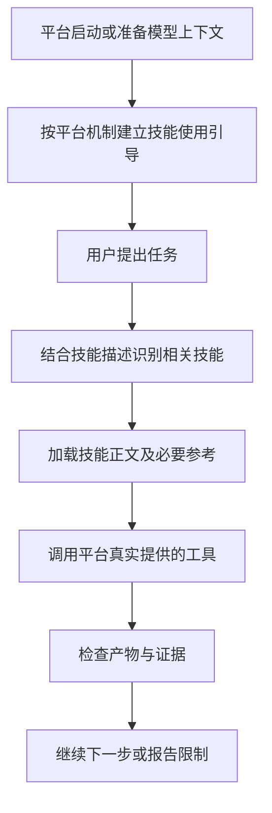

# Superpowers 学习清单：从使用流程到理解源码

> 阅读基线：本地仓库 v7.0.2，提交 `22f0b46`；整理日期：2026-11-21。版本信息来自根目录 `package.json` 和本地 Git 记录，不代表已核对远程最新版本。
>
> 使用方法：按顺序学习并勾选 `- [ ]`；每阶段留下笔记、流程图或实际会话证据。下面的练习与命令是后续学习建议，本次整理没有执行安装、构建或真实模型评估。

这份清单面向已经接触过软件开发、准备第一次系统学习 Superpowers 的读者。建议先掌握一个平台上的完整使用流程，再读平台适配代码，最后学习如何验证和改进技能。基础路线约 25～40 小时，可按每天 45～90 分钟安排 4～6 周；高级评估与扩展练习另计，耗时取决于环境和模型。

## 导航

1. [学习目标与概念](#01-学习目标与概念)
2. [仓库地图](#02-仓库地图)
3. [前置知识与环境](#03-前置知识与环境)
4. [启动与技能触发](#04-启动与技能触发)
5. [15 个技能总览](#05-15-个技能总览)
6. [需求澄清与实施计划](#06-需求澄清与实施计划)
7. [执行方式与上下文管理](#07-执行方式与上下文管理)
8. [测试驱动开发与系统调试](#08-测试驱动开发与系统调试)
9. [审查验证与分支收尾](#09-审查验证与分支收尾)
10. [平台适配源码](#10-平台适配源码)
11. [可视化辅助运行时](#11-可视化辅助运行时)
12. [任务辅助脚本](#12-任务辅助脚本)
13. [测试体系与验证边界](#13-测试体系与验证边界)
14. [技能编写与行为评估](#14-技能编写与行为评估)
15. [分级实践项目](#15-分级实践项目)
16. [学习安排与复习问题](#16-学习安排与复习问题)
17. [贡献前的规则](#17-贡献前的规则)
18. [学习记录模板](#18-学习记录模板)

## 01 学习目标与概念

### 1.1 学完应具备的能力

- [ ] 用自己的话解释 Superpowers 的目标：通过可组合技能与启动指令，组织 AI 编程代理的软件开发流程。
- [ ] 画出“需求 → 设计 → 计划 → 实现 → 审查 → 验证 → 收尾”的主要关系。
- [ ] 在自己实际使用的一个平台上确认技能被发现，并观察一次自动触发。
- [ ] 根据任务区分需求澄清、故障调试、计划执行和会话诊断。
- [ ] 找到一个行为对应的 `SKILL.md`、平台入口、辅助脚本及测试。
- [ ] 阅读一份实施计划，判断它是否足够明确、是否包含可检查的验收条件。
- [ ] 结合会话记录与命令输出，判断“代理说完成了”是否有证据支持。
- [ ] 在独立练习项目中完成一次从需求到验证的流程，并记录成本与不足。

### 1.2 需要理解的术语

| 术语 | 在本项目中的含义 | 学习时要问的问题 |
| --- | --- | --- |
| Coding agent | 能读取项目、操作工具并编写代码的 AI 代理 | 哪些动作由模型决策，哪些由工具执行？ |
| Harness | 承载代理的应用或 CLI，例如 Claude Code、Codex、OpenCode | 它提供哪些技能、文件、命令和子代理接口？ |
| Skill | 对可复用方法、规则或参考知识的说明，主要入口是 `SKILL.md` | 什么时候使用？要求什么行为？如何验证？ |
| Frontmatter | Markdown 开头的 YAML 元信息 | `name` 和 `description` 如何帮助发现技能？ |
| Bootstrap | 会话中建立技能使用规则的初始引导 | 这段内容如何进入模型上下文？ |
| Hook | 平台在特定生命周期事件上执行的逻辑 | 启动、清空、压缩时是否触发？ |
| Tool mapping | 将技能里的通用操作映射为平台实际工具 | 没有同名工具时，如何表达等价操作？ |
| Spec / design | 描述目标、约束、行为和方案的设计依据 | 要解决什么问题？哪些事情不做？ |
| Plan | 将设计拆成具体任务与验证步骤的实施计划 | 每一步是否足够明确？任务间接口是否一致？ |
| Subagent / SDD | 子代理；由控制者协调子代理实施与审查的开发方式 | 子代理获得多少上下文？谁负责整合与最终判断？ |
| Compaction | 长会话的上下文压缩 | 丢失细节后，如何恢复进度与引导规则？ |
| Ledger | 持久化的进度与裁决记录 | 哪些任务已完成？依据哪些提交、测试与审查？ |
| Eval | 对真实代理行为进行评估的实验 | 加入技能后，行为是否改善？能否重复观察？ |

### 1.3 建立正确的项目认识

- [ ] 理解本仓库主要提供技能、平台集成和辅助运行时；学习重点是代理行为与工程流程。
- [ ] 理解当前学习不要求先掌握模型训练、微调、PyTorch 或向量数据库。
- [ ] 区分“文件已经安装”“平台能列出技能”“模型加载了技能”“实际执行符合技能”四个层次。
- [ ] 理解技能中的强约束是给模型的行为指令，是否稳定遵循仍需要真实会话评估。
- [ ] 理解用户要求、项目约束与平台实际工具能力会影响技能的执行方式。

**阶段产出：** 写一段 200～300 字的项目介绍，并举例说明 Skill、Hook、Bootstrap 各自负责什么。

## 02 仓库地图

优先阅读：[README](../README.md)、[贡献约束](../AGENTS.md)、[版本记录](../RELEASE-NOTES.md)。先认识当前目录，再阅读历史方案。

| 路径 | 作用 | 优先级 |
| --- | --- | --- |
| [README.md](../README.md) | 定位、安装、基本流程、技能分类 | P0 |
| [skills/](../skills/) | 15 个技能及其参考资料、模板和脚本 | P0 |
| [skills/using-superpowers/SKILL.md](../skills/using-superpowers/SKILL.md) | 技能使用规则与平台适配入口 | P0 |
| [hooks/](../hooks/) | Shell Hook 配置、启动脚本和跨平台包装器 | P1 |
| [.codex-plugin/plugin.json](../.codex-plugin/plugin.json) | Codex 插件元信息与技能目录声明 | P1 |
| [.claude-plugin/](../.claude-plugin/) | Claude Code 插件与市场清单 | P1 |
| [.cursor-plugin/](../.cursor-plugin/) | Cursor 插件入口 | P2 |
| [.opencode/plugins/superpowers.js](../.opencode/plugins/superpowers.js) | OpenCode V1/V2 适配与引导注入 | P1 |
| [.pi/extensions/superpowers.ts](../.pi/extensions/superpowers.ts) | Pi 生命周期与上下文注入 | P2 |
| [gemini-extension.json](../gemini-extension.json)、[GEMINI.md](../GEMINI.md) | Gemini 扩展与上下文文件 | P2 |
| [.kimi-plugin/](../.kimi-plugin/)、[.hermes-plugin/](../.hermes-plugin/) | 其他平台的清单、工具映射和运行代码 | P2 |
| [.antigravity-plugin/](../.antigravity-plugin/)、[.devin-plugin/](../.devin-plugin/)、[.muse-plugin/](../.muse-plugin/) | 其他平台的插件声明 | P2 |
| [.agents/plugins/marketplace.json](../.agents/plugins/marketplace.json) | 仓库内的代理插件市场配置 | P2 |
| [package.json](../package.json)、[index.js](../index.js) | 包元信息、Pi 资源声明及 OpenCode 入口 | P1 |
| [scripts/](../scripts/) | Shell 检查、版本同步、打包与发布辅助 | P2 |
| [tests/](../tests/)、[docs/testing.md](testing.md) | 基础设施测试及测试体系说明 | P1 |
| [docs/superpowers/specs/](superpowers/specs/)、[docs/plans/](plans/) | 历史设计与计划，用于追踪演变 | P2 |
| [.github/PULL_REQUEST_TEMPLATE.md](../.github/PULL_REQUEST_TEMPLATE.md) | 上游贡献所需的问题、环境、评估和人工审查说明 | 贡献前必读 |

P0 表示入门必学，P1 表示理解实现时学习，P2 表示按兴趣深入；不要求一次读完所有平台。

- [ ] 找到上述入口，标记自己选择的平台。
- [ ] 确认根 `package.json` 当前没有 `scripts` 字段，不套用根目录 `npm test` 或 `npm run build`。
- [ ] 确认根包与测试子目录包的职责不同；插件零运行时依赖的设计不等于所有测试都不需要依赖。
- [ ] 阅读 `RELEASE-NOTES.md` 的 v7.0.2 部分，选三个修复，定位到实际实现。
- [ ] 给一份历史设计标注“当时的意图”，再检查当前源码是否仍按该方案实现。

**阶段产出：** 一张自己的目录职责图，能回答“需求流程在哪里”“启动在哪里”“验证在哪里”。

## 03 前置知识与环境

### 3.1 按需补齐基础

- [ ] Markdown：标题、链接、任务复选框、代码围栏和相对路径。
- [ ] YAML / JSON：理解技能元信息、插件清单与 Hook 配置。
- [ ] Git：提交、差异、分支、提交区间、merge base、worktree、detached HEAD。
- [ ] Shell：参数、环境变量、退出码、标准输入输出、工作目录、引用和路径空格。
- [ ] JavaScript：模块导入导出、异步函数、文件读取、事件回调与简单缓存。
- [ ] 需要读 Pi 时补充 TypeScript 类型标注；需要读 Hermes 时补充 Python 模块与路径处理。
- [ ] 需要读可视化服务时补充 HTTP、Cookie、WebSocket 和进程生命周期。
- [ ] 理解 TDD、回归测试、DRY、YAGNI、代码审查与最小可复现问题。

### 3.2 选择一个平台起步

- [ ] 从 [README 的安装章节](../README.md#installation) 选择自己正在使用的平台，只安装该平台所需集成。
- [ ] 记录平台版本、模型名称、Superpowers 版本、操作系统和 Shell。
- [ ] 区分“当前正在阅读源码的仓库”和“平台实际加载的插件目录”。
- [ ] 在后续实操前准备独立练习项目，避免把练习代码写进 Superpowers 核心目录。
- [ ] Windows 下辨别 PowerShell、Git Bash 与 WSL；确认实际调用的是哪一个 Bash。
- [ ] 理解 `D:\path`、`D:/path` 与 `/d/path` 的用途差异，避免把一种 Shell 的路径直接交给另一种。

### 3.3 本地学习约束

- [ ] 默认先阅读与静态检查；本工作区未经明确要求，不运行会触发前后端编译或构建的命令。
- [ ] 运行测试前先读脚本，确认是否调用模型、安装依赖、启动服务或写入文件。
- [ ] 只有计划修改的练习文件才进入改动范围；对现有无关文件不提交、不删除、不回退、不改写。
- [ ] 如确需新建分支，遵循当前约定 `caj/<issue-number>`，使用真实问题编号；本学习清单不需要创建分支。
- [ ] 设计与计划参考当前文档约定，不在已废弃的 `.kiro/` 中操作规范文档。

**阶段产出：** 一份环境记录；明确哪些操作现在可执行，哪些留到后续单独安排。

## 04 启动与技能触发

主读：[using-superpowers](../skills/using-superpowers/SKILL.md)。这一节是理解整个项目的入口。

### 4.1 阅读技能入口

- [ ] 找出 YAML 中的 `name`、`description`，解释描述怎样帮助模型判断使用时机。
- [ ] 阅读技能检查规则、技能优先级、平台适配和用户指令部分。
- [ ] 理解流程技能先确定方法，再由实现类技能执行具体操作。
- [ ] 为“做一个新功能”“修复失败测试”“执行已有计划”“解释会话为何重复工作”分别选择入口。
- [ ] 理解 `<SUBAGENT-STOP>` 的目的：被分派具体任务的子代理不应重新开启控制者的整套流程。
- [ ] 区分“技能目录被平台发现”和“启动引导建立使用规则”，分别查找对应代码。
- [ ] 理解通常先提供技能元信息，实际相关时再加载正文与必要参考文件的上下文管理思路。

### 4.2 先画概念链路，再查平台实现



这是概念图，具体机制要按平台查证。当前 Codex 清单的 `hooks` 是空对象，入口依赖原生技能发现；不能把 Claude Code 的 Shell Hook 链路套用到全部平台。

### 4.3 最小观察练习

- [ ] 在已正确安装的目标平台中开启一个干净会话。
- [ ] 发送项目规定的新平台集成验收原文：`Let's make a react todo list`。
- [ ] 观察是否在写代码前自动进入 `brainstorming`；第一轮只检查触发行为。
- [ ] 保存原始输入、技能加载事件、代理首轮响应和平台环境信息。
- [ ] 再开独立会话，显式请求一个技能，比较自动触发与显式调用。
- [ ] 若未触发，沿“插件安装 → 技能发现 → Bootstrap → 工具映射 → 实际会话”定位停在哪一步。

**验收标准：** 不靠代理口头声称“我有 Superpowers”，能指出相关加载记录及其后实际行为。

## 05 15 个技能总览

本地 `skills/` 当前包含以下 15 个技能。建议先读 P0，再把其他技能放回完整流程理解。

| 技能与入口 | 主要场景 | 阅读重点 | 优先级 |
| --- | --- | --- | --- |
| [using-superpowers](../skills/using-superpowers/SKILL.md) | 会话起步与技能选择 | 发现、优先级、平台映射、用户约束 | P0 |
| [brainstorming](../skills/brainstorming/SKILL.md) | 明确新工作要达到的结果 | 先理解意图、有效提问、方案与设计确认 | P0 |
| [writing-plans](../skills/writing-plans/SKILL.md) | 将已认可设计转成实施步骤 | 任务边界、接口、全局约束、Review Focus、自审 | P0 |
| [executing-plans](../skills/executing-plans/SKILL.md) | 当前会话逐任务亲自执行 | 任务简报、BASE、账本、完成契约、最终审查 | P0 |
| [test-driven-development](../skills/test-driven-development/SKILL.md) | 功能、修复与行为修改 | 观察预期失败、最小实现、保持测试通过 | P0 |
| [systematic-debugging](../skills/systematic-debugging/SKILL.md) | Bug、失败测试与异常行为 | 根因、对比、单一假设、验证修复 | P0 |
| [verification-before-completion](../skills/verification-before-completion/SKILL.md) | 宣称完成、修复或通过之前 | 先获得与结论对应的最新证据 | P0 |
| [using-git-worktrees](../skills/using-git-worktrees/SKILL.md) | 实施前管理隔离工作区 | 先识别已有隔离，优先原生工具，再考虑 Git 回退 | P1 |
| [subagent-driven-development](../skills/subagent-driven-development/SKILL.md) | 需要逐任务独立实施与审查 | 控制者、简报、报告、任务审查、修复循环 | P1 |
| [dispatching-parallel-agents](../skills/dispatching-parallel-agents/SKILL.md) | 多个独立问题可同时处理 | 独立性、共享状态、范围限制、结果整合 | P1 |
| [requesting-code-review](../skills/requesting-code-review/SKILL.md) | 请求独立检查变更 | 需求依据、完整差异、提交区间、问题等级 | P1 |
| [receiving-code-review](../skills/receiving-code-review/SKILL.md) | 收到审查建议 | 先核对事实，再修复或给出有依据的异议 | P1 |
| [finishing-a-development-branch](../skills/finishing-a-development-branch/SKILL.md) | 验证后决定集成方式 | 分支状态、合并/PR/保留、工作区归属与清理 | P1 |
| [diagnosing-superpowers](../skills/diagnosing-superpowers/SKILL.md) | 会话未触发、重复、偏离计划或成本异常 | 只读会话证据、可追溯结论、报告与按需导出 | P2 |
| [writing-skills](../skills/writing-skills/SKILL.md) | 开发、修改与验证可复用技能 | 触发描述、行为基线、压力场景、前后对照评估 | P2 |

### 每个技能都采用同一套阅读问题

- [ ] 用一句话写出触发条件，举一个应该触发和一个不该触发的例子。
- [ ] 找出主要输入、关键步骤、输出产物和结束条件。
- [ ] 找出硬性关口、允许的分支与异常处理方式。
- [ ] 找出它依赖或转入的其他技能。
- [ ] 阅读至少一条 Red Flags / Rationalizations，说明它试图阻止哪种代理错误。
- [ ] 标注工具依赖与平台差异，避免照抄不存在的工具名称。
- [ ] 找一个可观察的行为作为验收依据，避免只复述技能文字。

**阶段产出：** 为 15 个技能分别写一张简短卡片，允许先完成 P0 卡片再继续。

## 06 需求澄清与实施计划

### 6.1 Brainstorming：理解要做什么以及为什么

主读：[brainstorming](../skills/brainstorming/SKILL.md)，进阶读 [builder-check-prompt.md](../skills/brainstorming/builder-check-prompt.md)。

- [ ] 理解先阅读已有项目和用户提供材料，避免重复询问已经回答的问题。
- [ ] 区分“结果和原因还不清楚”与“关键内容已经明确”的请求；观察对应流程如何缩放。
- [ ] 识别有价值的问题：答案会改变最终产物，且现有材料没有答案。
- [ ] 理解意图未明确时的开放问题，以及已明确选择时的方案、权衡和推荐。
- [ ] 区分用户明确作出的决定与代理提出的建议，不把推断记成用户要求。
- [ ] 找到小改动的简短设计与完整项目设计的区别。
- [ ] 检查设计是否覆盖意图、目标、非目标、约束、备选方案和待实施者决定的部分。
- [ ] 阅读设计确认关口，以及用户选择跳过提问、明确同意临时探索时的处理分支。
- [ ] 理解完整项目设计中的 builder check 检查的是“是否足够让实施者规划”，小改动没有同样的完整检查要求。
- [ ] 理解视觉辅助只在图形有助于决策时提出，接受后也不把所有交流搬到浏览器。

**练习：** 在独立练习会话提出“我想做一个本地待办管理工具”，记录最初缺失的信息、实际提问、备选方案和最终确认内容。

**验收标准：** 设计能让另一位开发者说明要做什么、成功标准是什么、哪些需求被排除。

### 6.2 Writing Plans：将设计拆成可执行任务

主读：[writing-plans](../skills/writing-plans/SKILL.md)。

- [ ] 区分设计描述的目标与计划固定的实现决定。
- [ ] 阅读计划头部的 Goal、Architecture、Tech Stack、Spec。
- [ ] 理解 Global Constraints 将版本、命名、依赖和格式等全局要求带入每个任务。
- [ ] 理解 Review Focus：识别设计暗含但任务测试遗漏的输入或失败情况，并将相应测试归入负责的任务。
- [ ] 先明确文件职责，再拆任务，避免按“建文件、写所有代码、补全部测试”机械分组。
- [ ] 为每个任务列出文件、测试、Consumes / Produces 接口及可独立检查的产物。
- [ ] 检查每一步是否有可确认的结果，验证步骤是否写出命令及 Expected。
- [ ] 理解当前计划强调签名、确切值、断言与必要算法；不要求把所有显而易见的函数实现抄进计划。
- [ ] 完成覆盖、步骤明确性、类型一致性、Review Focus 和篇幅比例五项自审。
- [ ] 区分计划审阅与实施授权；保留用户已经选定的执行方式。
- [ ] 认识当前建议目录：设计为 `docs/superpowers/specs/`，计划为 `docs/superpowers/plans/`，用户指定位置优先。

**练习：** 将已确认设计拆成 3～5 个任务，逐项指出由哪个测试或静态检查验证。

**验收标准：** 另一个实施者只读设计、全局约束与自己的任务，就能确定接口、要求和验收方式。

## 07 执行方式与上下文管理

主读：[executing-plans](../skills/executing-plans/SKILL.md)、[subagent-driven-development](../skills/subagent-driven-development/SKILL.md)、[dispatching-parallel-agents](../skills/dispatching-parallel-agents/SKILL.md)。

### 7.1 比较两条计划执行路径

| 维度 | Executing Plans：当前会话执行 | Subagent-Driven Development：子代理实施 |
| --- | --- | --- |
| 实施者 | 当前代理逐任务实施 | 每个任务由控制者分派实施子代理 |
| 任务中的独立审查 | 不逐任务分派独立审查，依靠计划、TDD 与完成契约 | 每任务设独立审查关口，要求规格符合与质量两个结论 |
| 分支整体审查 | 最后进行一次整体审查；有子代理能力时使用新审查上下文 | 逐任务审查后仍进行整体审查 |
| 持久化记录 | 任务简报、进度账本、测试输出与裁决 | 简报、实施报告、审查包、账本与修复记录 |
| 上下文特点 | 复用当前上下文，长计划需防止压缩后遗漏 | 新任务上下文更聚焦，需要准确交接接口与约束 |
| 成本特点 | 通常减少反复加载上下文与逐任务审查席位 | 增加独立实施与审查，实际成本需测量 |
| 无子代理工具时 | 可以在当前会话执行，并如实说明审查方式 | 不虚构派发能力，采用适用的回退路径 |

- [ ] 理解当前版本的 `executing-plans` 是当前会话内执行，不能直接照搬旧教程中的其他定义。
- [ ] 阅读两条路径的设置、任务循环、完成条件和最终审查。
- [ ] 理解 SDD 当前任务审查要求两个判断，并不等于固定派两个独立审查代理。
- [ ] 理解 SDD 不允许并行派发多个实施子代理，以免共享工作区冲突。
- [ ] 将“有顺序依赖的实施任务”与“真正独立的问题调查”区分，后者才考虑并行技能。
- [ ] 为同一个小计划说明选择某种方式的理由：任务规模、接口依赖、审查需要与上下文长度。

### 7.2 理解持久化交接

- [ ] 找到每个计划的工作目录：仓库下 `.superpowers/sdd/` 中属于该计划的子目录。
- [ ] 区分任务清单的实时状态与 `progress.md` 账本的持久化记录。
- [ ] 理解 Task brief 是实施要求的主要来源；交接时传路径、接口和约束，避免重复粘贴整段会话。
- [ ] 阅读实施报告的 `DONE`、`DONE_WITH_CONCERNS`、`NEEDS_CONTEXT`、`BLOCKED` 四种状态。
- [ ] 理解任务开始前记录 BASE，审查覆盖该任务的全部提交。
- [ ] 解释为何多次提交的任务使用 `HEAD~1` 会漏掉之前的变更。
- [ ] 阅读 [resuming.md](../skills/subagent-driven-development/references/resuming.md)，用账本和 Git 记录恢复任务进度。
- [ ] 阅读 [preflight.md](../skills/subagent-driven-development/references/preflight.md)，理解实施前如何发现计划冲突。
- [ ] 阅读 [fix-loop.md](../skills/subagent-driven-development/references/fix-loop.md)，理解轮次上限、升级与裁决记录，避免无限修复和审查循环。
- [ ] 理解被记录的待处理问题仍是问题，不能把达到循环上限描述为所有问题均已解决。

### 7.3 上下文与成本

- [ ] 列出重复读取整份计划、粘贴完整历史、重复审查和重新派发已完成任务的成本来源。
- [ ] 理解任务简报、报告文件与审查包如何减少控制者上下文增长。
- [ ] 记录真实的会话时间、工具调用、代理轮次和可获得的 token 数据；缺失项写“未获得”。
- [ ] 理解便宜模型若需要更多往返，不一定降低总成本；模型选择需要结合任务与数据。

**阶段产出：** 一张执行方式对照表和一次中断恢复演练记录。

## 08 测试驱动开发与系统调试

### 8.1 Test-Driven Development

主读：[TDD](../skills/test-driven-development/SKILL.md)、[writing-good-tests.md](../skills/test-driven-development/writing-good-tests.md)。

- [ ] 解释 RED → GREEN → REFACTOR 各自的目标。
- [ ] 区分业务行为未实现导致的预期失败，与语法错误、导入错误、环境缺失。
- [ ] 解释为什么先看到预期失败，才能证明测试有能力识别缺失行为。
- [ ] 为一个小函数写能体现输入、输出与边界的测试，再写最小实现。
- [ ] 识别只验证 mock 被调用、只重复实现细节、没有行为断言的薄弱测试。
- [ ] 在保持测试通过时做一次小重构，确认没有顺手增加需求。
- [ ] 阅读技能对项目测试套件和已有失败的要求，区分单项通过与整体通过。
- [ ] 实操时结合项目限制选择可执行验证；受限未运行的部分单独记录，不用静态检查替代编译成功的结论。

**推荐练习：** 在独立练习项目实现“拒绝空白标题的待办项”，覆盖正常输入、空字符串和只有空格的输入。

### 8.2 Systematic Debugging

主读：[systematic-debugging](../skills/systematic-debugging/SKILL.md)，再读 [root-cause-tracing.md](../skills/systematic-debugging/root-cause-tracing.md)、[defense-in-depth.md](../skills/systematic-debugging/defense-in-depth.md)、[condition-based-waiting.md](../skills/systematic-debugging/condition-based-waiting.md)。

- [ ] 按四阶段记录一次问题：根因调查 → 模式分析 → 假设与验证 → 实施修复。
- [ ] 保存完整错误、复现步骤、最近变更和环境差异。
- [ ] 多组件问题先观察数据经过各层的证据，再缩小范围。
- [ ] 找到可工作的对照实现，逐项比较差异。
- [ ] 写出一个明确假设，设计只改变一个变量的最小验证。
- [ ] 为确认的根因建立失败测试，再验证修复与回归情况。
- [ ] 理解重复修复失败后应重新审视架构，不能无限叠加猜测。
- [ ] 解释条件等待相比固定延时的作用，以及超时边界仍为什么必要。

### 8.3 区分产品调试与会话诊断

| 情况 | 先读的技能 | 需要的证据 |
| --- | --- | --- |
| 函数返回错误、测试失败 | systematic-debugging | 输入、输出、错误、复现与代码变化 |
| 技能没触发、代理反复做同一任务 | diagnosing-superpowers | 对话、技能加载事件、工具调用、账本与时间线 |
| 即将报告“问题解决了” | verification-before-completion | 能直接支撑该结论的最新验证输出 |

**阶段产出：** 一份小 Bug 的“症状—证据—假设—根因—修复—验证”记录。

## 09 审查验证与分支收尾

### 9.1 请求与接收审查

主读：[requesting-code-review](../skills/requesting-code-review/SKILL.md)、[code-reviewer.md](../skills/requesting-code-review/code-reviewer.md)、[receiving-code-review](../skills/receiving-code-review/SKILL.md)。

- [ ] 给审查者提供要求、设计/计划路径、完整提交区间和必要约束。
- [ ] 区分“符合规格”与“实现质量”，测试通过不自动代表两者都满足。
- [ ] 按 Critical、Important、Minor 理解问题优先级与后续处理。
- [ ] 收到建议后先核对现有实现、兼容性和需求，不机械接受所有修改。
- [ ] 为采纳、拒绝或延期的建议记录理由，拒绝时提供技术证据。
- [ ] 理解在 SDD 中要使用该流程记录的 BASE；审查技能的一般示例不能替代多提交任务的完整区间。

### 9.2 完成前的证据

主读：[verification-before-completion](../skills/verification-before-completion/SKILL.md)。

- [ ] 对每条结论写出相应证据：“链接有效”“测试通过”“需求完成”分别如何证明。
- [ ] 执行适用验证，读取输出与退出码，避免仅相信子代理的成功报告。
- [ ] 检查全部验收条件，列出未测、失败和受环境限制的项目。
- [ ] 区分格式检查、静态检查、测试、构建与真实会话观察分别能证明什么。

### 9.3 工作区与集成决定

主读：[using-git-worktrees](../skills/using-git-worktrees/SKILL.md)、[finishing-a-development-branch](../skills/finishing-a-development-branch/SKILL.md)。

- [ ] 理解已有 linked worktree、普通仓库和子模块的识别，避免重复创建隔离区。
- [ ] 理解原生工作区工具优先，以及手动 Git 回退的适用条件。
- [ ] 区分普通分支、detached HEAD 和平台托管工作区。
- [ ] 确定真实基线分支，不默认所有项目都向 `main` 合并；本仓库上游 PR 目标为 `dev`。
- [ ] 阅读当前技能的菜单：普通分支提供本地合并、创建 PR、保留；detached HEAD 的选择有所不同。
- [ ] 理解丢弃工作只在用户明确要求时处理，不能因学习结束自行删除分支或工作区。
- [ ] 理解工作区归属、未提交文件和清理范围；阅读示例不等于获得清理授权。

**阶段产出：** 一份包含变更、验收证据、已知限制和待决定集成方式的完成报告。

## 10 平台适配源码

主读：[porting-to-a-new-harness.md](porting-to-a-new-harness.md)。先精读自己使用的平台，再选一个不同机制的平台对照。

### 10.1 平台机制对照

| 平台 | 当前本地入口 | 主要引导机制 | 需要重点观察的差异 |
| --- | --- | --- | --- |
| Claude Code | [.claude-plugin/plugin.json](../.claude-plugin/plugin.json)、[hooks/hooks.json](../hooks/hooks.json) | SessionStart Shell Hook | 注入字段、事件匹配、同步执行 |
| Codex | [.codex-plugin/plugin.json](../.codex-plugin/plugin.json) | 原生技能发现，`using-superpowers` 的描述引导加载 | 当前 `hooks: {}`，工具以真实可用清单为准 |
| Cursor | [.cursor-plugin/plugin.json](../.cursor-plugin/plugin.json)、[hooks-cursor.json](../hooks/hooks-cursor.json) | 平台自己的 sessionStart Hook 配置 | 配置结构与 `additional_context` 输出字段 |
| Gemini CLI | [gemini-extension.json](../gemini-extension.json)、[GEMINI.md](../GEMINI.md) | 声明的上下文文件引用技能与工具映射 | `contextFileName`、文件引用与加载位置 |
| OpenCode | [.opencode/plugins/superpowers.js](../.opencode/plugins/superpowers.js) | 进程内注册技能，并在会话消息链路注入 | V1/V2 API、工具名、缓存、去重与子会话 |
| Pi | [package.json](../package.json)、[superpowers.ts](../.pi/extensions/superpowers.ts) | 包声明技能资源，扩展处理生命周期及 context 事件 | 每次提供者请求的引导、压缩摘要位置与去重 |
| Kimi Code | [.kimi-plugin/plugin.json](../.kimi-plugin/plugin.json) | 清单中的 `sessionStart.skill` | 内嵌 `skillInstructions` 工具映射 |
| Antigravity | [.antigravity-plugin/plugin.json](../.antigravity-plugin/plugin.json) | 暴露技能描述，借助入口技能被发现 | 无同样的会话启动 Hook，安装与市场字段 |
| Hermes Agent | [plugin.yaml](../.hermes-plugin/plugin.yaml)、[__init__.py](../.hermes-plugin/__init__.py) | `pre_llm_call` 插件 Hook | 技能目录定位、子代理识别与长会话限制 |

此表是本地版本的阅读索引。其他平台继续查 README 和对应清单；源码、参考映射和平台实际工具清单应交叉核对。

### 10.2 Shell Hook 链路

- [ ] 沿 `hooks.json → run-hook.cmd → session-start → using-superpowers/SKILL.md → JSON 输出` 跟踪一次数据流。
- [ ] 找到 `startup|clear|compact` 的事件匹配含义。
- [ ] 找到 `session-start` 如何确定插件根目录、读取技能、转义 JSON。
- [ ] 对比 Claude Code 的 `hookSpecificOutput.additionalContext`、Cursor 的 `additional_context` 和其他平台输出分支。
- [ ] 理解同时输出多种平台字段为什么可能造成重复注入。
- [ ] 阅读 [Windows polyglot 说明](windows/polyglot-hooks.md)，理解一个包装器兼容批处理与 Unix Shell 的方式。
- [ ] 理解 Hook 脚本没有 `.sh` 扩展名的原因，以及找不到 Bash 时的行为。
- [ ] 注意 `session-start` 避免外部子进程、处理异常 PATH 和管道关闭的实现原因。

### 10.3 OpenCode：最适合深入阅读的 JavaScript 适配

- [ ] 对比根 `package.json` 的 `main` 与根 `index.js` 的再导出，理解包安装和目录入口的关系。
- [ ] 阅读 `extractAndStripFrontmatter`，找出支持的字段写法以及它不是完整 YAML 解析器的边界。
- [ ] 对比 `V1_MAPPING` 与 `V2_MAPPING`，记录技能 ID 和工具参数的实际差异。
- [ ] 阅读 `getBootstrapContent` 与 `_bootstrapCache`，区分文件读取缓存和上下文重复注入检查。
- [ ] 理解使用 Bootstrap 固定开头去重，而非只查某个普通单词。
- [ ] 找到 V1 的 `config` 与消息 transform，理解技能注册和引导注入分别发生在哪里。
- [ ] 找到 V2 的 `setup`、`ctx.skill.transform` 与 `context/compaction/generate` Hook。
- [ ] 理解按 `parentID` 识别子会话，避免给具体任务执行者注入控制者流程。
- [ ] 将以上每个行为关联到 `tests/opencode/` 的对应测试。

### 10.4 Pi 与其他平台作为对照

- [ ] 在 Pi 扩展中找到 `session_start`、`session_compact` 和 `context` 处理器。
- [ ] 解释为什么处理器返回的临时消息未写回历史时，每次提供者请求仍需携带引导。
- [ ] 找到 `messageContainsBootstrap` 与 `firstNonCompactionSummaryIndex`，说明二者解决的问题。
- [ ] 区分代码中的类型导入与新增第三方运行时依赖。
- [ ] 选 Gemini、Kimi 或 Hermes 中一个，对照其引导路径与工具映射。

**阶段产出：** 为两个平台分别画出“入口—技能发现—引导—工具调用”的链路，并指出至少三项差异。

## 11 可视化辅助运行时

这一部分适合希望继续读实际服务代码的人。基础技能学习可以先完成，再回来看。

阅读顺序：[visual-companion.md](../skills/brainstorming/visual-companion.md) → [start-server.sh](../skills/brainstorming/scripts/start-server.sh) → [server.cjs](../skills/brainstorming/scripts/server.cjs) → [helper.js](../skills/brainstorming/scripts/helper.js) → [frame-template.html](../skills/brainstorming/scripts/frame-template.html) → [stop-server.sh](../skills/brainstorming/scripts/stop-server.sh)。

- [ ] 区分视觉辅助的适用场景、启动前的用户选择，以及文字交流仍承担的部分。
- [ ] 找到内容片段如何被包装成完整页面，完整 HTML 又如何被处理。
- [ ] 跟踪“写入屏幕内容 → 浏览器展示 → 点击选择 → 记录事件 → 代理读取”的闭环。
- [ ] 区分 `content` 与 `state` 的职责，理解项目内 `.superpowers/brainstorm/` 会话目录。
- [ ] 阅读启动输出中的 URL、端口、内容目录与状态目录，理解重启如何找到原会话。
- [ ] 在 `server.cjs` 中定位 HTTP 请求、WebSocket upgrade、广播与活动时间更新。
- [ ] 理解会话 key、认证 Cookie、Origin 检查和内容路径限制分别约束什么。
- [ ] 理解端口冲突、进程前后台、不同平台的进程回收与停止逻辑。
- [ ] 定位品牌资源与遥测开关的处理，参考 README 的 Visual companion telemetry 说明。
- [ ] 将认证、协议、生命周期和 Windows 路径行为对应到 `tests/brainstorm-server/`。

**阶段产出：** 一张浏览器、Node 服务、内容文件和事件记录之间的数据流图。

## 12 任务辅助脚本

这些脚本把计划、任务状态与审查材料落实为文件。先读接口和测试，再在独立练习仓库运行。

| 脚本 | 阅读时追踪的输入 | 主要输出或职责 |
| --- | --- | --- |
| [sdd-repo](../skills/subagent-driven-development/scripts/sdd-repo) | 当前目录或调用方指定目录 | 校验并识别目标 Git 仓库 |
| [sdd-workspace](../skills/subagent-driven-development/scripts/sdd-workspace) | 计划文件、可选 `-C DIR` | 找到属于该计划的工作目录与身份标记 |
| [task-brief](../skills/subagent-driven-development/scripts/task-brief) | 计划路径、任务 ID | 提取单个任务的简报文件 |
| [review-package](../skills/subagent-driven-development/scripts/review-package) | 计划路径、BASE、HEAD | 包含提交、统计与完整差异的审查文件 |
| [task-start](../skills/executing-plans/scripts/task-start) | 计划路径、任务 ID | 为当前会话执行准备任务简报与基线信息 |
| [task-done](../skills/executing-plans/scripts/task-done) | 计划、任务 ID、BASE、测试命令 | 执行测试，成功后写入完成记录 |

- [ ] 找到脚本如何以执行时的工作目录确定目标仓库，避免错误操作插件缓存中的仓库。
- [ ] 理解“使用脚本绝对路径”和“在业务工作树中运行”是两个同时需要满足的条件。
- [ ] 理解 `-C DIR` 的目录选择作用，确认实际仓库与预期一致。
- [ ] 理解计划路径身份标记与同名计划冲突处理，不能随意使用另一个计划的目录。
- [ ] 阅读任务标题规则：保留英文 `Task` 与任务 ID，例如 `### Task 1: 标题`，其余内容可以用中文。
- [ ] 理解 `Task 6`、`Task 6b`、`Task A1`、`Task 2.1` 的精确匹配与子任务边界。
- [ ] 找到未闭合代码围栏如何让任务提取变得不可靠，以及脚本如何拒绝不完整简报。
- [ ] 理解 Windows 下输出 `C:/...` 路径的原因。
- [ ] 解释脚本通过 `bash` 等解释器调用的意义，尤其是打包后可执行位丢失的情况。
- [ ] 阅读 [test-sdd-workspace.sh](../tests/claude-code/test-sdd-workspace.sh)、[test-executing-plans-scripts.sh](../tests/claude-code/test-executing-plans-scripts.sh)、[test-sdd-helper-paths.sh](../tests/sdd-helper-paths/test-sdd-helper-paths.sh)，将边界条件与实现对应。

**阶段产出：** 选一个脚本，写明参数、工作目录、前置条件、写入位置、失败退出行为及对应测试。

## 13 测试体系与验证边界

主读：[docs/testing.md](testing.md)、[Claude Code 测试说明](../tests/claude-code/README.md)。测试目录的名字不直接代表它是否离线，必须阅读实际脚本。

### 13.1 分清三类验证

| 层次 | 主要验证什么 | 示例 | 不能单独证明的事 |
| --- | --- | --- | --- |
| 静态与结构检查 | 语法、元信息、引用、文件布局、大小或清单字段 | `tests/skill-layout/`、`tests/skill-size/`、Shell 语法检查 | 模型实际会不会遵循流程 |
| 基础设施测试 | Hook 输出、技能注册、消息注入、缓存、脚本边界与服务行为 | `tests/hooks/`、`tests/opencode/`、`tests/brainstorm-server/` | 真实平台上的完整用户体验 |
| 真实会话与行为评估 | 是否正确触发、遵守关口、完成任务、避免重复及控制成本 | 部分 `tests/claude-code/`、`tests/explicit-skill-requests/`、独立 eval 实验室 | 所有模型和平台上都同样有效 |

### 13.2 阅读测试的顺序

- [ ] 先选 `tests/hooks/test-session-start.sh`，看它如何构造环境、解析 JSON 并断言字段。
- [ ] 读 `tests/opencode/`，理解平台 API 测试替身如何验证注册、缓存与去重。
- [ ] 读 `tests/pi/test-pi-extension.mjs`，理解生命周期事件与消息顺序断言；运行前核对 Node 对 TypeScript 加载的支持。
- [ ] 读 `tests/brainstorm-server/package.json`，确认测试子包依赖与测试顺序。
- [ ] 读 `tests/claude-code/run-skill-tests.sh` 与辅助文件，标出实际调用 Claude CLI 的位置。
- [ ] 读 `tests/explicit-skill-requests/` 中一个提示与运行脚本，区分“知道技能名字”与“实际按技能执行”。
- [ ] 选择一个版本修复，检查其回归测试是否能在错误实现下失败。

### 13.3 可以先做的只读定位与静态检查

以下示例均从仓库根目录执行；它们用于后续学习，本次文档整理没有执行这些测试命令。Shell 示例需要先确认工具可用。

```powershell
# 阅读与定位，适用于当前 PowerShell 环境
Get-Content -Raw skills/using-superpowers/SKILL.md
rg -n '^name:|^description:' skills -g SKILL.md
rg -n 'getBootstrapContent|BOOTSTRAP_MARKER|parentID' .opencode/plugins/superpowers.js
git diff --check
```

```bash
# 只检查指定脚本语法，不执行脚本；需要 Git Bash 或相应 Unix 环境
bash -n hooks/session-start

# 只解析 JavaScript 语法，不启动插件或服务；需要 Node.js
node --check .opencode/plugins/superpowers.js
```

- [ ] 了解 `scripts/lint-shell.sh` 的默认范围、依赖与选项；`--format` 会改写文件，阅读或检查时不要误用。
- [ ] 如要运行 Hook 测试，先检查 `tests/hooks/test-session-start.sh` 需要的 Bash、Node 和临时文件行为，再安排执行。
- [ ] 如要运行 brainstorm-server 测试，先进入其测试子目录查看说明与依赖，不在根目录盲目执行 `npm test`。
- [ ] 对每条测试记录命令、执行目录、环境、耗时、退出码、通过/失败项及未运行项。

### 13.4 真实模型评估

当前本地检出没有 `evals/` 目录。仓库文档将行为评估指向独立的 [superpowers-evals](https://github.com/prime-radiant-inc/superpowers-evals/)；后续准备运行时，以该仓库当时的 README 为准。

- [ ] 理解 Quorum 是该评估体系中的运行 CLI，场景包含验收标准与确定性后置检查。
- [ ] 理解“插件连线正确”与“代理在压力下仍遵循流程”要分别评估。
- [ ] 阅读评估环境与执行模型，确认需要哪些真实 CLI、认证和运行资源。
- [ ] 根据本仓库测试文档预估：真实场景可能耗时 3～30 分钟以上，并产生模型调用成本。
- [ ] 先选一个场景建立基线，再比较技能变化后的结果，保存原始会话与指标。
- [ ] 区分静态评估检查与真实会话运行，避免把它们视为同一种成本。

**阶段产出：** 一份验证矩阵，每项写明“验证什么、如何验证、实际结果、仍未证明什么”。

## 14 技能编写与行为评估

进阶主读：[writing-skills](../skills/writing-skills/SKILL.md)，再读 [discovery.md](../skills/writing-skills/references/discovery.md)、[testing-skills-with-subagents.md](../skills/writing-skills/references/testing-skills-with-subagents.md)、[bulletproofing.md](../skills/writing-skills/references/bulletproofing.md)。

### 14.1 技能结构与发现

- [ ] 理解 Technique、Pattern、Reference 三类技能各自的目标。
- [ ] 识别可跨任务复用的方法、一次性说明和项目专属约定之间的区别。
- [ ] 阅读 `name` / `description` 的命名、触发条件、关键词与大小要求。
- [ ] 解释为什么描述应聚焦使用时机，避免让模型只看摘要而跳过正文。
- [ ] 理解主文件、重型参考、模板和可复用脚本如何分工，避免无必要地拆散内容。
- [ ] 阅读流程图规则，理解何时图比文字更容易消除分支歧义。
- [ ] 理解技能内容的长度会影响发现、加载和上下文成本。

### 14.2 用行为实验验证技能

- [ ] 先描述真实的行为失败，再决定需要技能、结构模板还是可自动执行的检查。
- [ ] RED：在没有待验证技能的条件下，记录代理在哪种任务或压力下失败。
- [ ] GREEN：只加入针对已观察问题的最小指令，观察同类任务是否改善。
- [ ] REFACTOR：根据实际遗漏与合理化行为调整，再用新会话复测。
- [ ] 对行为措辞按当前技能要求进行小规模重复实验，再进行完整压力场景；两者分别保留记录。
- [ ] 设置成功标准与不应退化的行为，防止只提高“遵循流程”却损害任务结果或成本。
- [ ] 尽量保持任务、平台、模型与执行条件一致，记录无法控制的变量。
- [ ] 报告失败次数、重复次数与具体证据；单次成功只能说明该次观察。
- [ ] 理解修改 Red Flags、合理化列表与 “human partner” 等行为塑造内容，需要充分评估依据。

### 14.3 安排一个个人实验

- [ ] 选择一个自己确实反复遇到的小问题，先在独立练习目录或个人插件中实验。
- [ ] 设计至少一个适用场景、一个不应触发的相邻场景和一个存在压力的场景。
- [ ] 建立无技能基线、加入技能后的结果和回归观察表。
- [ ] 如涉及子代理，明确本次实验的派发范围与成本，遵循所用平台实际支持的能力。
- [ ] 完成后评价“是否改善了可观察行为”，再考虑是否值得复用或推广。

**阶段产出：** 一份带原始证据的前后对照实验；是否贡献上游另按第 17 节判断。

## 15 分级实践项目

以下是后续可选练习，不要求一次做完。所有代码实验放在独立练习项目中；开始实施前明确文件范围与允许的验证命令。

### L1：只读理解，约 2～3 小时

- [ ] 完成 README、using-superpowers、brainstorming 和 writing-plans 的首次阅读。
- [ ] 写出 15 个技能的用途，并为四类常见请求选择入口。
- [ ] 画出自己使用的平台启动链路。
- [ ] 找到一个 v7.0.2 修复的实现与测试位置。

**交付物：** 项目介绍、技能卡片和一张启动图。

### L2：跑通一个最小闭环，约 4～6 小时

建议项目：本地待办管理小工具，只需要新增、列表、标记完成三个行为，数据可先保存在内存。

- [ ] 在干净会话观察新功能请求是否自动进入需求澄清。
- [ ] 明确标题规则、完成状态、错误输入和本次不做的功能。
- [ ] 获得可供实施的设计与 3～5 个任务的计划。
- [ ] 选择一种执行方式，记录选择依据。
- [ ] 对“空白标题不能新增”和“完成状态切换”至少各完成一次可观察的 RED → GREEN。
- [ ] 让审查覆盖规格、错误输入和实现质量。
- [ ] 按计划验收并报告实际验证结果；学习完成时可以保留在本地，不要求创建 PR。

**交付物：** 设计、计划、练习代码、测试证据、审查记录与完成报告。

### L3：故障定位与恢复，约 3～5 小时

在 L2 练习项目的授权范围内设置一个可复现问题，例如重复标题的行为不符合设计；不要改动 Superpowers 核心来制造故障。

- [ ] 写清预期与实际差异，按四阶段调试定位根因。
- [ ] 先得到能复现问题的失败测试，再修复并检查回归。
- [ ] 模拟停止与继续：只读取计划、账本和 Git 记录，判断下一项任务。
- [ ] 用一次真实会话记录分析是否发生重复工作，不凭印象统计。
- [ ] 阅读 diagnosing-superpowers 的证据与引用要求；会话文件保持只读。

**交付物：** 根因报告、中断恢复记录与带位置引用的会话观察。

### L4：执行策略对照，约 4～8 小时

- [ ] 为同一个小需求准备两份状态一致的练习副本与两个独立会话。
- [ ] 分别使用当前会话执行和 SDD，避免同一工作树上的实现互相影响。
- [ ] 尽量保持设计、计划、平台、模型配置与验收标准一致。
- [ ] 比较总耗时、实施轮次、审查发现、未完成项、返工次数和可获得的 token 数据。
- [ ] 解释差异可能来自哪里，并明确小样本的局限。

**交付物：** 有原始记录支撑的对照表，不预设哪种方式必然更好。

### L5：个人技能实验或平台深读，时间另计

二选一：按第 14 节验证一个个人技能；或完整跟踪 OpenCode/Pi 的引导注册、去重、压缩恢复和测试。

- [ ] 为选择的方向写明确问题与验收标准。
- [ ] 给关键行为找到源码依据和验证方法。
- [ ] 记录失败情况和仍未确认的结论。
- [ ] 整理可复现的笔记，便于隔一周后重新完成同样验证。

**交付物：** 一份实验报告或源码导读。

## 16 学习安排与复习问题

### 16.1 建议进度

| 周次 | 主要内容 | 对应章节 | 完成标志 |
| --- | --- | --- | --- |
| 第 1 周 | 认识项目、环境、启动和核心技能 | 01～06、L1 | 能说明流程，并知道每一步读哪个文件 |
| 第 2 周 | 计划执行、TDD、调试与验收 | 07～09、L2 | 完成最小闭环并留下证据 |
| 第 3 周 | 自己的平台与另一种适配方式 | 10～12 | 两条源码链路及一个脚本导读 |
| 第 4 周 | 测试体系、恢复练习、复盘 | 13、L3 | 能区分验证层次，并从记录恢复进度 |
| 第 5～6 周，可选 | 技能评估、策略比较与扩展 | 14、L4/L5、17 | 有对照实验或完整源码笔记 |

时间紧时先完成 P0 与 L2；遇到暂不熟悉的平台先记问题，不中断主线去安装所有工具。

### 16.2 自测问题

- [ ] 为什么只把 `skills/` 放在磁盘上，还不能证明集成已生效？
- [ ] `description`、技能正文、平台工具映射分别解决什么问题？
- [ ] 新功能、失败测试、已有计划和会话重复工作分别应从哪个技能开始？
- [ ] 当前 Codex、Claude Code 与 OpenCode 的引导路径有什么不同？
- [ ] 缓存文件读取与避免重复注入为什么是两件事？
- [ ] 设计和计划有什么区别？计划为什么需要明确接口与全局约束？
- [ ] 当前会话执行与 SDD 的审查时机、上下文和成本有什么差异？
- [ ] 为什么 SDD 与并行调查不能混为一谈？
- [ ] 任务已经提交两次时，审查为什么不能只看 `HEAD~1..HEAD`？
- [ ] 上下文压缩后，哪些磁盘记录支持继续执行？
- [ ] 预期测试失败、导入失败和运行环境失败应如何区分？
- [ ] 为什么静态检查通过不能证明构建、需求或真实代理行为通过？
- [ ] 哪些测试会调用模型？如何在运行前识别成本与环境要求？
- [ ] 如果要修改技能中的一句话，怎样证明行为改善且没有明显退化？
- [ ] 准备贡献上游时，哪些材料必须由人审阅或亲自撰写？

**掌握标准：** 不只给出术语解释，还能为答案指出一个本地文件和一个具体例子。

## 17 贡献前的规则

学习与个人实验不等于需要提交上游。确实准备贡献时，重新完整阅读 [AGENTS.md](../AGENTS.md) 和 [PR 模板](../.github/PULL_REQUEST_TEMPLATE.md)，以下只是提醒。

- [ ] 问题来自自己真实经历的会话、错误或用户体验，有可核查的复现材料。
- [ ] 查询相关的开放与已关闭 PR；发现重复时停止重复提交并说明情况。
- [ ] 如果问题是他人报告且没有维护者邀请代理提交修复，遵循仓库要求补充自己的报告，不直接提交代理编写的修复 PR。
- [ ] 判断变更是否适合通用核心；个人、项目或领域专属工作优先作为独立插件。
- [ ] 保持一个 PR 解决一个问题，遵守零运行时依赖的设计与仓库明确的例外条件。
- [ ] 如修改技能，使用 `superpowers:writing-skills`，完成多会话压力测试并展示前后评估结果。
- [ ] 如新增平台，提供干净会话中原文 `Let's make a react todo list` 在写代码前自动触发 brainstorming 的完整记录。
- [ ] 如新增版本化清单，核对 [.version-bump.json](../.version-bump.json)；阅读打包与同步脚本，不直接运行发布动作。
- [ ] PR 以 `dev` 为目标，完整填写模板，披露模型、运行环境、环境版本和用于贡献的插件。
- [ ] Human-authored summary 由本人用自己的话填写，少于 200 词。
- [ ] 在提交前由本人查看完整差异并明确批准；不把自动生成的学习笔记直接当成待提交贡献。
- [ ] 提交、删除、回退或改写前确认文件属于当前授权范围。

## 18 学习记录模板

下面的模板可复制到自己的笔记中。建议记录最少但足够复现的信息，原始输出较大时保存文件路径。

### 18.1 单次学习记录

```markdown
# Superpowers 学习记录：日期 / 主题

## 环境
- Superpowers 版本与提交：
- 平台及版本：
- 模型与可确认的配置：
- 操作系统 / Shell：

## 本次目标
- 要解释或验证的问题：
- 阅读文件：

## 理解与证据
- 我的解释：
- 对应源码 / 文档位置：
- 实际观察或输出路径：
- 尚未验证的部分：

## 下次继续
- 当前停在哪里：
- 下一步：
```

### 18.2 技能卡片

```markdown
## 技能名称
- 触发条件：
- 不适用的相邻场景：
- 输入与必要上下文：
- 核心步骤 / 分支：
- 关口与结束条件：
- 输出产物：
- 工具与平台差异：
- 关联技能与参考文件：
- 常见失败：
- 验证它实际生效的方法：
```

### 18.3 验证与实验结果

| 问题或验收项 | 条件 / 输入 | 方法与执行目录 | 实际结果与证据位置 | 未验证部分 |
| --- | --- | --- | --- | --- |
| 待填写 | 待填写 | 待填写 | 待填写 | 待填写 |

### 18.4 总进度

- [ ] 能介绍项目并完成技能卡片。
- [ ] 能证明所选平台上的技能发现与自动触发。
- [ ] 完成需求到验证的最小实践闭环。
- [ ] 能阅读两个平台的启动与适配链路。
- [ ] 能阅读一个辅助脚本及其测试。
- [ ] 能区分静态检查、基础设施测试与行为评估。
- [ ] 能借助账本和提交记录恢复任务。
- [ ] 能用证据解释一次失败或一项改进。
- [ ] 已明确个人后续方向：熟练使用 / 源码研究 / 技能实验 / 平台集成。
